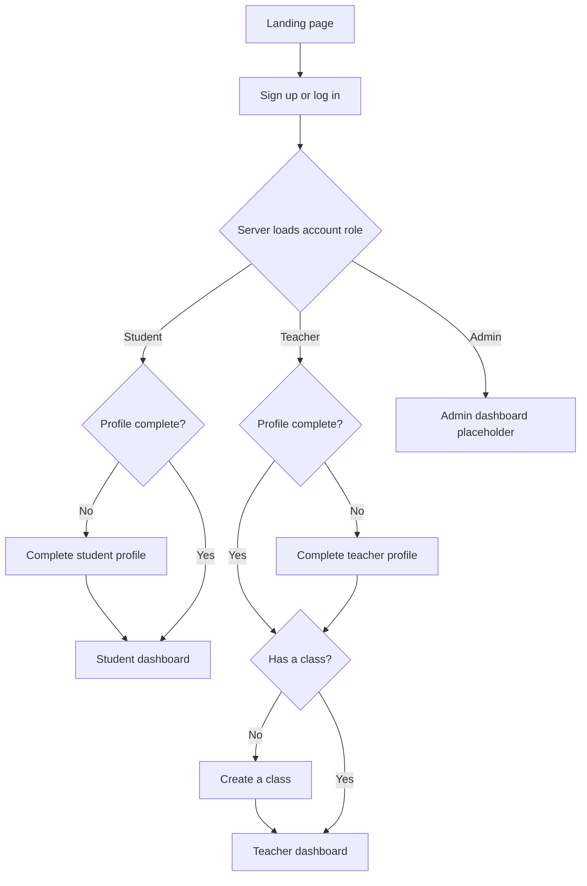

# Attendy

> **Beyond the Roll Call.**

Attendy is an attendance platform for students and teachers. Students can review attendance across their subjects and over time. Teachers can set up their profile and create classes. Accounts are created as students by default; an administrator can assign other roles once role management is implemented.

## Product flow and current scope



Implemented today:

- Sign up and log in with a Thapar (`@thapar.edu`) email and password.
- Passwords are hashed before storage. Auth.js issues a JWT-backed session; protected server routes look up the current account and role in PostgreSQL.
- New accounts receive the `student` role in the database. The role is never accepted from a sign-up form or trusted from client-side state.
- Students complete a display-name profile and see their attendance summary, today’s sessions, subject progress, and activity heatmap.
- Teachers complete a display-name profile and can create classes. A teacher without a class is guided to class creation.
- Admin routes are protected, but the admin dashboard and role-management tools are placeholders.

The database schema also contains enrollments, class sessions, and attendance records. Student enrollment workflows, teacher session scheduling, QR scanning/check-in, attendance entry, and admin role management still need implementation. The dashboard therefore shows empty states when there is no data.

## Architecture

Attendy is a Next.js application with server-side database access; it does not run a separate backend service. Server Components and server actions use Drizzle ORM and the `pg` driver to connect to PostgreSQL. The browser never connects directly to the database.

Development runs the Next.js app and a local PostgreSQL server as separate Docker Compose services. This local database is a real PostgreSQL container with a persistent named volume, not a mock database. Production Compose runs the app and connects to a PostgreSQL database supplied through `DATABASE_URL`; it does not start a database container. This lets a deployed app instance share the same central database as other authorized app instances.

## Technology stack

| Area | Technology | Use |
| --- | --- | --- |
| Web application | Next.js 16 App Router, React 19, TypeScript | Server-rendered routes, layouts, and server actions |
| Authentication | Auth.js v5 Credentials provider | Email/password sign-in and JWT-backed sessions |
| Input validation | Zod 4 | Shared validation for credentials, profiles, and class forms |
| Password security | Node.js `scrypt` | Password hashing and verification |
| Database | PostgreSQL 17 | Persistent account, class, enrollment, session, and attendance data |
| Database access | Drizzle ORM and Drizzle Kit | Typed queries, schema definitions, migrations, and Studio |
| PostgreSQL driver | `pg` | Server-side database connections |
| UI | Tailwind CSS 4, Base UI, shadcn components, Remix Icon | Responsive styles, accessible primitives, and icons |
| Fonts and theme | Geist through `next/font`, CSS tokens | Typography and light/dark themes |
| Runtime and packages | Node.js 22, npm 10 | App runtime and locked dependencies (`package-lock.json`) |
| Local environment | Docker, Docker Compose | Repeatable app and database workflow |

## Repository map

```text
app/
  (marketing)/                 Landing page
  (auth)/                      Login, signup, and signup server action
  (dashboard)/dashboard/       Role-aware dashboard routes and server actions
    student/                   Student profile and attendance dashboard
    teacher/                   Teacher profile, class creation, and dashboard
    admin/                     Protected admin placeholder
  api/auth/                    Auth.js route handler
  globals.css                  Tailwind imports and global theme tokens
components/
  auth/                        Login and signup forms
  dashboard/                   Responsive navigation and profile/class forms
  theme/                       Light/dark theme toggle
  ui/                          Shared UI primitives
db/
  index.ts                     Server-side PostgreSQL connection and Drizzle instance
  schema.ts                    PostgreSQL enums and table definitions
drizzle/                       Generated SQL migrations and snapshots
lib/
  auth/                        Password, session-user, login, and redirect helpers
  validations/                 Zod schemas
compose.yaml                   Development app and local PostgreSQL
compose.production.yaml        Production app using external PostgreSQL
Dockerfile                     Development and production image stages
AGENTS.md                      Repository instructions for coding agents
```

## Development with Docker Compose

### Requirements

- Docker Desktop with Docker Compose
- Ports `3000`, `4983`, and `5432` available on the host

Run commands from the project root (`E:\Dev\repos\attendy` in the current Windows workspace). Compose looks for its YAML file in the current directory.

Start the development app and its PostgreSQL database:

```powershell
docker compose up --build
```

Open [http://localhost:3000](http://localhost:3000). The app runs in Next.js development mode. Inside the Compose network it connects to PostgreSQL at `db:5432`; database tools on the host can connect to `localhost:5432`. The app and database data are stored in named Docker volumes for dependencies, Next.js cache, and PostgreSQL data.

On a fresh database, apply the checked-in migrations from a second terminal:

```powershell
docker compose exec app npm run db:migrate
```

Stop the foreground `up` process with `Ctrl+C`, or stop services from another terminal:

```powershell
docker compose down
```

`docker compose down` preserves the database volume. `docker compose down -v` removes named volumes and permanently deletes the local database contents; use it only when you intentionally want to erase that local database.

### Everyday commands

Run these in the project root. Use `docker compose exec app ...` for project commands so they use the container’s Node and npm dependencies.

| Command | Purpose |
| --- | --- |
| `docker compose up --build` | Build and run the development app and local PostgreSQL |
| `docker compose logs -f app db` | Follow app and database logs |
| `docker compose exec app npm run lint` | Run ESLint in the app container |
| `docker compose exec app npm run db:migrate` | Apply committed migrations to the configured database |
| `docker compose exec app npm run db:generate` | Generate a migration from schema changes |
| `docker compose exec app npm run db:studio` | Start Drizzle Studio on port `4983` |
| `docker compose restart app` | Restart the development app container |

While Drizzle Studio is running, open [https://local.drizzle.studio/?host=localhost](https://local.drizzle.studio/?host=localhost). Its connection reaches the app container through the host-bound port `4983`.

Do not start another host-side Next.js server for development or visual checks. If package dependencies change, rebuild the app with `docker compose up --build` so the container matches `package-lock.json`.

## Database workflow

1. Define or update tables, enums, constraints, and indexes in `db/schema.ts`.
2. Generate a migration inside the app container:

   ```powershell
   docker compose exec app npm run db:generate
   ```

3. Review the generated SQL under `drizzle/` for the intended PostgreSQL changes.
4. Apply the migration locally:

   ```powershell
   docker compose exec app npm run db:migrate
   ```

5. Commit the schema and its migration together.

Migrations are the source of truth for database structure. Do not rely on a local persistent volume to carry schema changes to another environment. Do not edit a migration that has already been applied to a shared or production database; add a follow-up migration instead.

Current tables:

| Table | Purpose |
| --- | --- |
| `users` | Email, password hash, role, display name, and profile completion timestamp |
| `subjects` | Classes created by teachers, with class code and optional room |
| `enrollments` | Student-to-class membership, unique per student and class |
| `class_sessions` | Scheduled class sessions with start/end time and room |
| `attendance_records` | Per-student attendance status for a class session |

## Production Compose

Production Compose runs only the app. It requires an already provisioned PostgreSQL database reachable from the app container.

1. Create a private `.env` from `.env.example` and provide:
   - `DATABASE_URL`: PostgreSQL connection string reachable from inside Docker.
   - `AUTH_URL`: public URL of the deployed app.
   - `AUTH_SECRET`: unique, high-entropy secret for this deployment.
2. Build the production app image:

   ```powershell
   docker compose -f compose.production.yaml build app
   ```

3. Apply migrations against the configured external database:

   ```powershell
   docker compose -f compose.production.yaml run --rm app npm run db:migrate
   ```

4. Start the app:

   ```powershell
   docker compose -f compose.production.yaml up -d
   ```

Inside the app container, `localhost` refers to that container. Set `DATABASE_URL` to the database host/service reachable from the app container. Never commit real credentials or the production `.env` file.

## npm scripts

| Script | Purpose |
| --- | --- |
| `npm run dev` | Start Next.js in development mode |
| `npm run build` | Build the production app |
| `npm run start` | Start the production Next.js server |
| `npm run lint` | Run ESLint |
| `npm run db:generate` | Generate SQL migrations from the Drizzle schema |
| `npm run db:migrate` | Apply generated migrations |
| `npm run db:studio` | Start Drizzle Studio on port `4983` |

During development, run these from the app service with `docker compose exec app <command>`.
